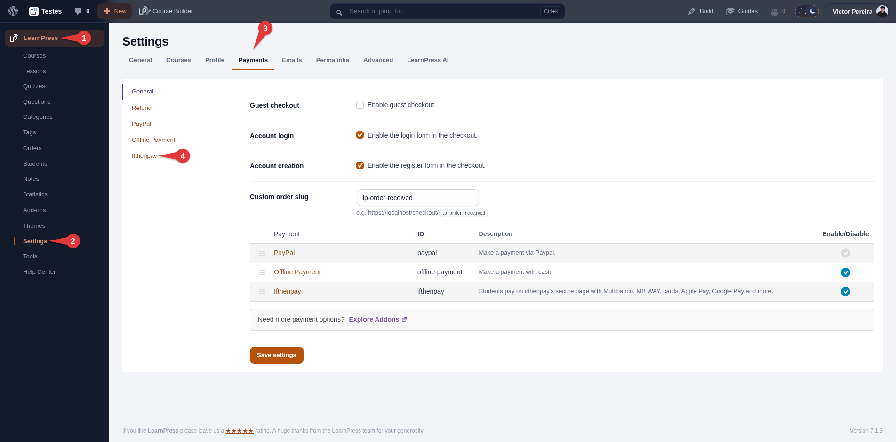
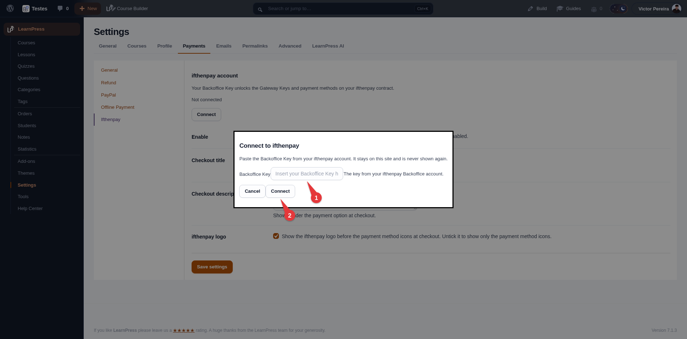
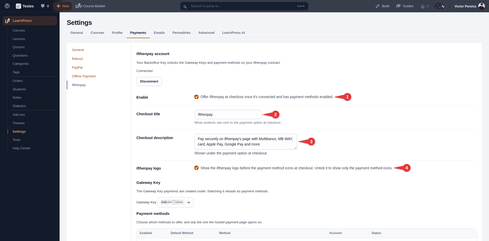
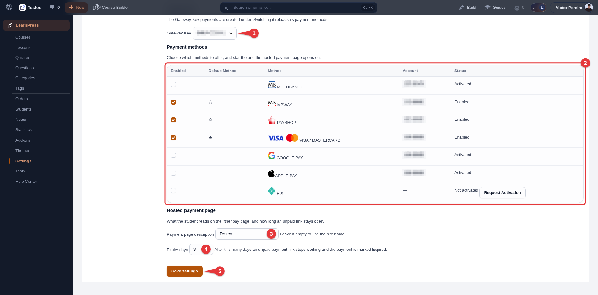
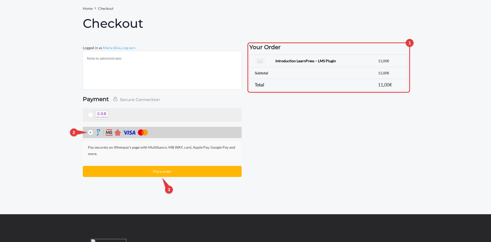
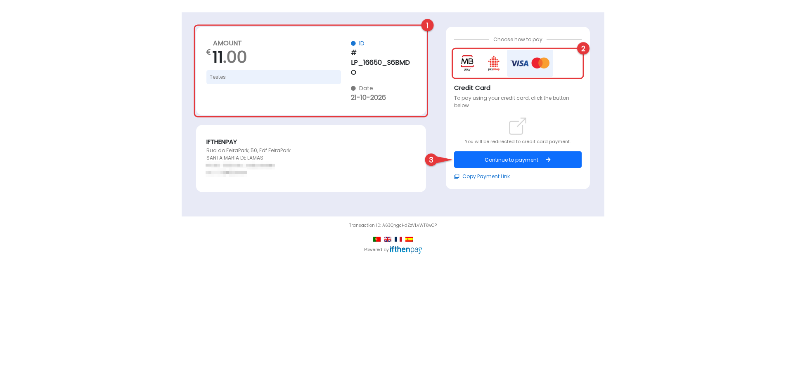
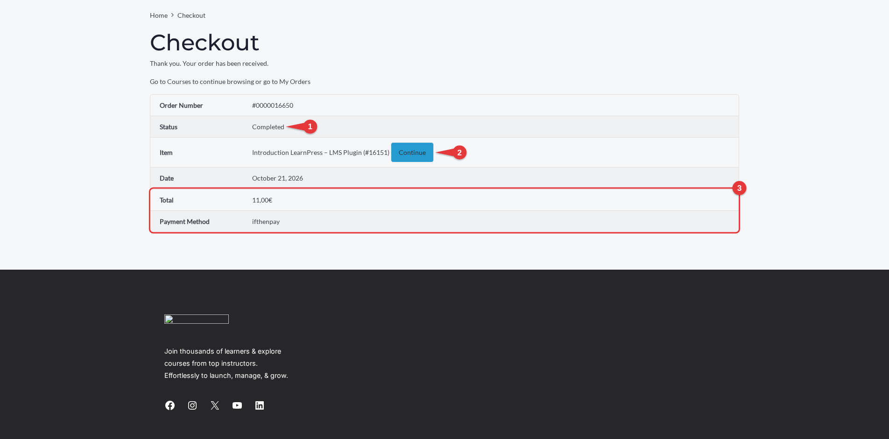
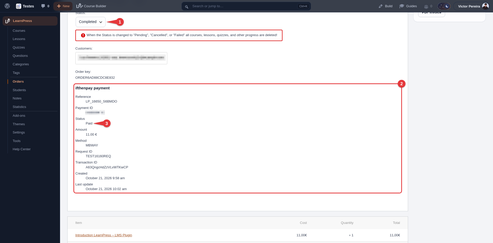

# ifthenpay | Payments for LearnPress

Adds ifthenpay payment methods to LearnPress: cards, wallets, and local payment options; supports secure one-time payments via pay-by-link.

---

## Table of Contents

- [Description](#description)
- [Key Features](#key-features)
- [Requirements](#requirements)
- [Installation](#installation)
- [Frequently Asked Questions](#frequently-asked-questions)
- [External Services](#external-services)
- [Screenshots](#screenshots)
- [Support](#support)
- [Security](#security)
- [Changelog](#changelog)

### Description

This plugin integrates the ifthenpay payment gateway with LearnPress to enable seamless payment collection directly from the LearnPress checkout. Payments are processed through a secure pay-by-link system, ensuring that no sensitive card or banking data is stored on your website. Students can complete payments using their preferred method via a secure payment page. After placing their order, students are redirected to ifthenpay's secure hosted payment page to complete the transaction; ifthenpay then sends a server-side callback, and LearnPress completes the order and enrolls the student automatically.

**In plain terms you get:**

- One-time payments for your courses, right from the native LearnPress checkout
- Payment amount automatically follows the LearnPress order total (course price and sale price)
- Merchant backoffice (basic sales) on web + mobile
- Secure automatic payment confirmations (no card numbers stored)

All settings are made in LearnPress and in your ifthenpay Backoffice. The plugin is built so site owners can manage payments without needing deep technical knowledge.

### Key Features

1. Full integration with LearnPress as a native payment method, next to PayPal and Offline Payment
2. Secure transactions
3. Automatic payment confirmation: the order completes and the student is enrolled as soon as ifthenpay confirms the payment
4. Support for multiple payment methods (Multibanco, MB WAY, Payshop, Pix, Credit Card and more — whatever's enabled on your Gateway Key)
5. Payment methods catalog synced live from your ifthenpay account, with in-admin "Request Activation" for methods not yet enabled
6. Secure full-page redirect to ifthenpay's hosted payment page
7. Real-time payment status on the LearnPress order screen (status, amount, method, request and transaction IDs, payment link and earlier attempts)
8. The order-received page shows where the payment stands and updates on its own; "Pay now" and "Try again" let students finish an unpaid order
9. One open payment link per student and course, so the same course can't be paid twice
10. Refunds through LearnPress's own refund flow for card, MB WAY, Apple Pay and Google Pay payments
11. Multi-language support (EN, ES, FR, PT)
12. Security first (no card data stored)

### Requirements

- An active ifthenpay merchant account — [subscribe here](https://ifthenpay.com/aderir/) to obtain your credentials.
- A LearnPress Gateway Key (request this from ifthenpay support/helpdesk).
- The payment methods you want enabled on that Gateway Key (our helpdesk team will guide you).
- WordPress 6.4+ and PHP 7.4+, and LearnPress installed and activated.
- LearnPress currency set to Euro (€).
- HTTPS (SSL) enabled on your site, with the WordPress REST API reachable from the internet (ifthenpay calls it back).

### Installation

1. **Install:** Upload the plugin zip via `Plugins → Add New → Upload`, or install from WordPress.org and Activate.
2. **Credentials:** Ensure your ifthenpay account has an active LearnPress Gateway Key with the desired payment methods enabled.
3. **Setup:** Follow the steps below. The numbers in each list match the red markers on that step's screenshot in the [Screenshots](#screenshots) section.

#### Step 1 — Open the ifthenpay settings

1. Open **LearnPress** in the admin menu.
2. Click **Settings**.
3. Open the **Payments** tab.
4. Click **ifthenpay**.

(screenshot 1)

#### Step 2 — Connect your ifthenpay account

1. Under **ifthenpay account**, click **Connect**, then paste your **Backoffice Key**.
2. Click **Connect**.

(screenshot 2)

#### Step 3 — Enable ifthenpay at checkout

1. Tick **Enable**.
2. **Checkout title**: the name students see next to the payment option.
3. **Checkout description**: shown under the payment option at checkout.
4. **ifthenpay logo**: show the ifthenpay logo before the payment method icons, or only the method icons.

(screenshot 3)

#### Step 4 — Choose your Gateway Key and payment methods, then save

1. Choose your **Gateway Key** (only needed if you have more than one).
2. Tick the **payment methods** to offer and star the **default method**. For a method that isn't active yet, click **Request Activation**.
3. **Payment page description**: shown on the ifthenpay payment page (empty uses your site name).
4. **Expiry days**: how long an unpaid payment link stays valid.
5. Click **Save settings**.

(screenshot 4)

The callback URL is registered with ifthenpay automatically when you connect, switch Gateway Key or save.

#### What your students see

At checkout (screenshot 5):

1. Check **your order**: the course and the total.
2. Choose **ifthenpay**. The logos show the payment methods you can use.
3. Click **Place order** to go to the ifthenpay payment page.

On the ifthenpay payment page (screenshot 6):

1. Check the **amount** and the order **ID** (your LearnPress order reference).
2. Choose **how to pay**. The default method you starred in the settings is preselected.
3. Follow the method’s instructions, e.g. **Continue to payment** for a card.

Back on your site (screenshot 7):

1. Once ifthenpay confirms the payment, the order is **Completed** on its own.
2. The student is enrolled: **Continue** opens the course right away.
3. The order shows the **total** and **ifthenpay** as the payment method.

#### That's it

There's nothing to set per course: ifthenpay shows at checkout for every paid course, as long as your LearnPress currency is Euro. Every payment also shows on the LearnPress order (screenshot 8):

1. LearnPress marks the order **Completed** on its own once ifthenpay confirms the payment, and the student is enrolled.
2. The **ifthenpay payment** block: reference, payment ID, status, amount, method, request and transaction IDs.
3. The payment **status**, updated by ifthenpay's callback.

### Frequently Asked Questions

<strong>Does this plugin require LearnPress?</strong>

Yes. LearnPress must be installed and active to use this plugin.

<strong>Does it support recurring payments?</strong>

No. This version supports only one-time payments via pay-by-link. LearnPress subscription plans can't be paid with ifthenpay.

<strong>Which currency does it support?</strong>

Euro only. If your LearnPress currency is set to anything else, ifthenpay is hidden at checkout and the admin shows a notice.

<strong>Are payment details stored?</strong>

No. The plugin does not store card numbers or full bank details. It keeps a record of each payment attempt (reference, amount, method, status, the student's name and email, and the payment link) so you can follow it up. That data is included in WordPress's personal data export and removed by its eraser.

<strong>Which payment methods are supported?</strong>

Any ifthenpay method attached to your Gateway Key (e.g. Multibanco, MB WAY, Payshop, Pix, Credit Card, and more).

<strong>How does the payment process work?</strong>

After placing the order at checkout, students are redirected to a secure ifthenpay-hosted payment page. Once payment is completed, the status is updated automatically via callback: LearnPress completes the order and enrolls the student. The student lands on LearnPress's order-received page, which updates on its own.

<strong>What happens if a payment fails?</strong>

The order stays Pending, and the attempt is marked as Failed on the LearnPress order. The student can try again from the order-received page or with "Pay now" in their profile's Orders.

<strong>How do refunds work?</strong>

Card, MB WAY, Apple Pay and Google Pay payments can be refunded through ifthenpay from LearnPress's own refund flow (refund requests must be allowed in LearnPress › Settings › Payments › Refund). Multibanco and Payshop payments have to be refunded another way.

<strong>Is there a sandbox?</strong>

ifthenpay may provide test entities; if unavailable, use a low-value live test.

<strong>How secure is the integration?</strong>

Requests are encrypted over HTTPS; no sensitive payment data is stored.

<strong>Does ifthenpay's addon for LearnPress accept webhooks(Callbacks)?</strong>

Yes! ifthenpay's addon for LearnPress accepts webhooks(callbacks).

### External Services

This plugin integrates with the ifthenpay payment platform to process payments for LearnPress orders. ifthenpay is a third-party service that provides secure payment processing for local payment methods such as Multibanco, MB WAY, Payshop, and Pix, plus Credit Card and more, depending on what's enabled on your account.

- **LearnPress**
  - **What it is and what it is used for**: A learning management system plugin used to sell courses. This plugin extends its payment capabilities.

- **ifthenpay Backoffice & Integrations**
  - **What it is and what it is used for**: The ifthenpay Backoffice is the merchant dashboard used to manage integrations and payment configurations. The plugin uses the ifthenpay API to generate payment links, validate transactions and process refunds.
  - **What data is sent and when**:
    - During setup: Backoffice Key and Gateway Key for authentication and configuration retrieval.
    - During payment processing: Order reference ID, amount, description, enabled payment method accounts, success/error/cancel return URLs, language, link expiry date, and optionally the selected payment method position. No student name, email, or address data is included in this request.
    - During webhook registration: the Gateway Key, its anti-phishing key and this site's callback URL, so ifthenpay can notify the site directly when a payment resolves.
    - During refunds: the Backoffice Key, the payment's request ID and the amount.
    - During payment method activation requests: when an admin requests activation of a new payment method from `LearnPress → Settings → Payments → ifthenpay`, an email is sent to ifthenpay support (suporte@ifthenpay.com) containing the Backoffice Key, Gateway Key, the requested payment method, the admin's email address, site URL, site name, WordPress version, LearnPress version, and plugin version.
    - During callbacks: Payment status and payment method.
  - **End-User License Agreement (EULA)**: [EULA](https://ifthenpay.com/eula/)
  - **Privacy Policy**: [Privacy Policy](https://ifthenpay.com/politica-de-privacidade/)

- **ifthenpay payment method logos**
  - **What it is and what it is used for**: The logos of your enabled payment methods, shown next to the ifthenpay option at checkout and in the settings' methods table, loaded from ifthenpay (gateway.ifthenpay.com).
  - **What data is sent and when**: The visitor's browser loads the images when it opens the checkout page (or an admin opens the settings), which sends ifthenpay their IP address and browser details, as any image request does. No order or student data is sent.
  - **End-User License Agreement (EULA)**: [EULA](https://ifthenpay.com/eula/)
  - **Privacy Policy**: [Privacy Policy](https://ifthenpay.com/politica-de-privacidade/)

Apart from those images, all network requests are performed server-side over HTTPS. Sensitive credentials are stored securely and are not publicly exposed. No raw card or bank details are stored.

### Screenshots

Below are screenshots demonstrating key features and interfaces of the plugin:

1. **(Admin Only) Step 1: open LearnPress → Settings → Payments → ifthenpay**
   
2. **(Admin Only) Step 2: connect your ifthenpay account with the Backoffice Key**
   
3. **(Admin Only) Step 3: enable ifthenpay and set what students see at checkout**
   
4. **(Admin Only) Step 4: choose the Gateway Key, payment methods, payment page and save**
   
5. **(Customers Experience) LearnPress Checkout**
   
6. **(Customers Experience) ifthenpay Payment Gateway Secure Payment Page**
   
7. **(Customers Experience) Paid order on the order-received page**
   
8. **(Admin Only) The ifthenpay payment on the LearnPress order**
   

### Support

For assistance use the [WordPress.org support forum](https://wordpress.org/support/plugin/ifthenpay-payments-for-learnpress/):

Pre-checks:

- Payment method enabled on Gateway Key AND mapped to Integration
- LearnPress currency set to Euro (€)
- Your site's REST API reachable from the internet
- Running current recommended versions of WordPress, PHP, & LearnPress

Commercial helpdesk available (no direct email required): [helpdesk.ifthenpay.com](https://helpdesk.ifthenpay.com/)

- **ifthenpay support**: [suporte@ifthenpay.com](mailto:suporte@ifthenpay.com)
- **LearnPress docs**: [LearnPress docs](https://docs.thimpress.com/learnpress/)

### Security

Found a security issue? Please report it privately to [suporte@ifthenpay.com](mailto:suporte@ifthenpay.com) with "Security" in the subject, rather than in the public support forum. See [SECURITY.md](SECURITY.md) for the full policy.

### Changelog

Releases that fix a security issue say so in their entry, prefixed with **Security:**.

#### 1.0.0

- Initial public release: ifthenpay Pay by Link gateway for the LearnPress checkout, webhook-confirmed payments that complete the LearnPress order and enroll the student, ifthenpay payment details on the LearnPress order screen, a self-updating payment status on the order-received page, "Pay now" and "Try again" for unpaid orders, one open payment link per student and course, refunds through LearnPress's refund flow, and automatic expiry of stale payment links.
